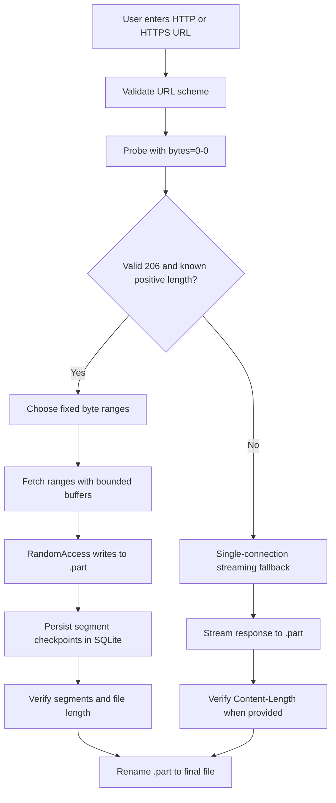

# HyperDL architecture

This English-language note describes the current implementation, not a future
design. HyperDL is a Windows WPF desktop application. Its UI coordinates
download jobs, while the `HyperDL.Core` namespace owns URL validation, HTTP
probing, segmentation, file writes, progress reporting, settings, and recovery
metadata. These related types remain together rather than creating folders
with only one or two files.

## Download flow

1. `MainWindow` accepts a direct HTTP/HTTPS file URL and uses
   `DownloadUrlValidator` to reject unsupported schemes.
2. `HttpProbe` requests byte zero and only marks range support when the server
   returns a valid `206 Partial Content` response and matching `Content-Range`.
3. `DownloadEngine` uses one streaming connection when range support or a known
   positive file size is unavailable. Otherwise, it builds a fixed segment
   layout before starting the workers.
4. Each worker reads into a bounded buffer and writes directly to the temporary
   file. Segment workers use `RandomAccess.WriteAsync` at the segment offset;
   the fallback uses sequential `FileStream` writes.
5. Completion validates the received data and moves the `.part` file to its
   final path. It does not launch the downloaded file.

## Segment and connection policy

- Supported connection choices are Auto, 1, 2, 4, 8, 16, 32, and 64.
- Auto selects a target from the known file size. The actual count is reduced
  when the file cannot provide that many segments of at least 4 MiB each.
- The application shares a global connection limiter across active workers.
- Fixed ranges are persisted; dynamic splitting and adaptive connection
  changes are not implemented.
- A server that rejects or does not reliably confirm ranges uses the
  single-connection fallback. Pause and resume are available only to the
  persisted segmented-download path.

## Memory and disk

Network data is read in bounded buffers and written to disk incrementally.
HyperDL does not place a complete file or segment in a `MemoryStream`. The
buffer size is 64 KiB in Low RAM mode and 80 KiB otherwise. Actual process
memory also depends on the runtime, UI, SQLite, and active workers, so these
buffer sizes are not a total-memory guarantee.

Incomplete segmented downloads use a `.part` file sized for the known source.
Segment offsets and checkpoints are stored separately in SQLite; the database
does not contain downloaded file bytes. A successful job renames the temporary
file to its final name.

## Persistence and recovery

The database is stored at `%LOCALAPPDATA%\HyperDL\hyperdl.db`; settings are
stored at `%LOCALAPPDATA%\HyperDL\settings.json`. Database records include
download metadata and segment offsets. At startup, interrupted downloading
records are marked recoverable. Before resuming, HyperDL probes the source
again and checks available file size, ETag, Last-Modified, and range
information to avoid joining data from a changed source.

Unknown-length or non-range fallback downloads are not persisted as resumable
sessions. Pause/resume and crash recovery are therefore not available for that
path.

## Current boundaries

- Supported network schemes: HTTP and HTTPS direct-file URLs.
- Not implemented: FTP/FTPS, BitTorrent, dynamic segmentation, automatic
  updates, and DRM or access-control bypass.
- Downloads and settings belong to the user; normal application uninstall
  does not remove download folders or `%LOCALAPPDATA%\HyperDL`.

See [the supported protocol notes](reference/PROTOCOLS.md),
[the threat model](reference/THREAT_MODEL.md), and the
[user guide](user-guides/USER_GUIDE.en.md). Traditional Chinese:
[架構說明](ARCHITECTURE.zh-TW.md).
