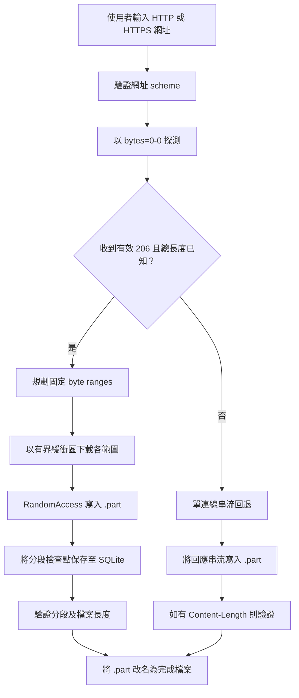

# HyperDL 架構

本文件描述目前程式碼的實際行為，不是未來設計提案。HyperDL 是 Windows WPF 桌面應用程式。
UI 負責協調下載工作；`HyperDL.Core` namespace 負責網址驗證、HTTP 探測、分段、檔案寫入、
進度、設定及恢復 metadata。相關類別依用途分資料夾，但保留原有 namespace。

## 下載流程

1. `MainWindow` 接受直接 HTTP/HTTPS 檔案網址，使用 `DownloadUrlValidator` 拒絕不支援的 scheme。
2. `HttpProbe` 要求 byte 0；只有伺服器回傳有效 `206 Partial Content` 與相符的 `Content-Range`
   時，才判定支援 Range。
3. 若未確認 Range 支援，或檔案大小不是已知正數，`DownloadEngine` 使用單一串流連線；否則先建立
   固定分段配置，再啟動 Workers。
4. 每個 Worker 將網路資料讀入有界緩衝區，然後直接寫入暫存檔。分段 Worker 使用
   `RandomAccess.WriteAsync` 寫至指定 offset；單連線回退則使用循序 `FileStream` 寫入。
5. 完成前會驗證資料，並將 `.part` 改名為正式檔案。下載器不會自動啟動已下載檔案。

## 分段與連線策略

- 支援 Auto、1、2、4、8、16、32、64 連線選項。
- Auto 依已知檔案大小選擇目標連線數；若無法提供足夠數量、且各段至少 4 MiB 的分段，實際數量會降低。
- 所有工作共用全域連線限制器。
- 固定分段配置會保存；尚未實作動態拆分或自適應連線調整。
- 伺服器拒絕或無法可靠確認 Range 時會使用單連線回退。只有可保存的分段下載支援暫停及繼續。

## 記憶體與磁碟

網路資料以有界緩衝區讀取，再逐步寫入磁碟。HyperDL 不會以 `MemoryStream` 保存完整檔案或完整分段。
Low RAM 模式的緩衝區為 64 KiB，一般模式為 80 KiB。整體程序記憶體也受 .NET Runtime、UI、
SQLite 及活動 Worker 數量影響，因此上述數值不是程序總記憶體上限。

已知大小的分段工作會建立相應大小的 `.part` 檔案。分段 offset 及檢查點另存於 SQLite；
資料庫不包含下載檔案內容。工作成功完成後會將暫存檔改名為正式檔案。

## 保存與恢復

資料庫位置為 `%LOCALAPPDATA%\HyperDL\hyperdl.db`；設定位於
`%LOCALAPPDATA%\HyperDL\settings.json`。資料庫保存下載 metadata 及分段 offset。
程式啟動時，會將先前處於下載中或暫停過程中的工作標記為可恢復。繼續前會重新探測來源，
並比較可取得的檔案大小、ETag、Last-Modified 及 Range 資訊，避免混合不同版本的資料。

未知長度或不支援 Range 的回退下載不會保存為可續傳工作階段，因此不具備該路徑的暫停／繼續
及當機恢復功能。

## 目前支援範圍

- 支援 HTTP 及 HTTPS 直接檔案網址。
- 不支援 FTP/FTPS、BitTorrent、動態分段、自動更新，也不提供 DRM 或存取控制繞過。
- 下載及設定屬於使用者資料；一般解除安裝不會刪除下載目錄或 `%LOCALAPPDATA%\HyperDL`。

其他語言版本：[English](ARCHITECTURE.md)。

參考：[支援協定](reference/PROTOCOLS.zh-TW.md)、[威脅模型](reference/THREAT_MODEL.zh-TW.md)、
[使用指南](user-guides/USER_GUIDE.md)。
